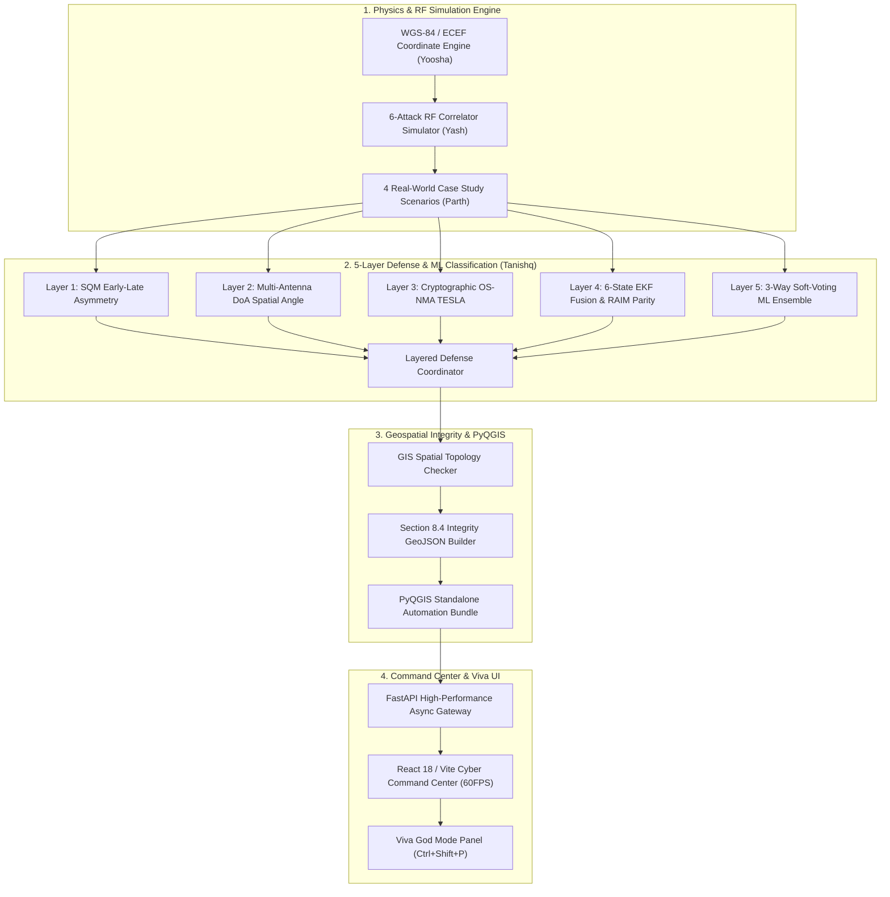

# AEGIS-GIS: When Location Lies
### Multi-Layered GNSS Spoofing Detection, EKF Sensor Fusion & Integrity-Aware GIS Pipeline

[](#)
[-success)](#)
[](#)
[](#)
[](#)
[-informational)](#)

---

## 1. Executive Summary & Research Context

Modern critical infrastructure—spanning civil aviation, commercial maritime shipping, autonomous drone logistics, and precision agriculture—operates under an unstated, dangerous assumption: **geographic coordinates delivered by GNSS receivers represent ground truth.** 

In reality, unencrypted civilian satellite signals ($L_1\text{ C/A}$) arrive at Earth’s surface with extremely low received power ($\approx -160\text{ dBW}$, or $10^{-16}\text{ W}$), rendering receivers completely defenseless against ground-based RF counterfeit transmitters.

**AEGIS-GIS** is an end-to-end cyber-geospatial defense architecture built to solve this crisis. It pairs high-fidelity RF physics signal simulation, a 5-layer physical/cryptographic/kinematic defense coordinator, a multi-model soft-voting machine learning ensemble, and an integrity-aware GIS topology validation engine with automated PyQGIS symbology.

---

## 2. Research Paper Contribution Matrix & Author Roles

| Author & Roll Number | Research Paper Responsibility | Technical Artifacts & Code Implementation in AEGIS-GIS |
| :--- | :--- | :--- |
| **Yoosha**<br>`16014224101` | **Abstract, Introduction, Section 2 & Section 3**<br>• Mathematical formulation of multilateration<br>• Coordinate systems (WGS-84, ECEF, UTM)<br>• Structural RF vulnerabilities of GNSS ($10^{-16}\text{ W}$ signal floor) | • `backend/physics/coordinates.py`: Closed-form Bowring/Heikkinen ellipsoidal conversions ($< 10^{-4}\text{ m}$ roundtrip error), Karney Transverse Mercator UTM projection engine, and iterative Weighted Least Squares (WLS) pseudorange solver.<br>• Receiver RF power budget modeling and clock drift estimation. |
| **Yash**<br>`16014224077` | **Section 4: Historical Antecedents & 6-Attack Taxonomy**<br>• Classification of GNSS spoofing vectors<br>• Correlator peak distortion dynamics<br>• Signal power advantage & code/carrier alignment | • `backend/physics/signal_simulator.py`: High-fidelity RF physics engine generating all 6 attack profiles: *Simplistic Non-Sync, Intermediate Sync, Sophisticated Receiver-Aware, Meaconing, Nulling & Suppression, and Drift-Evasive UAV*.<br>• 41-tap correlator early-to-late distortion profiler ($-2.0$ to $+2.0$ chips). |
| **Parth**<br>`16014224095` | **Section 5: Real-World Case Studies (2023–2025)**<br>• Aviation: Vilnius runway landing abort (2025)<br>• Maritime: Baltic Sea tanker runway teleportation (C4ADS 2024)<br>• UAV: Drift-evasive surveying breach<br>• Agriculture: Autonomous tractor crop-row drift | • `backend/physics/scenarios.py` & `backend/simulations/scenario_engine.py`: 4 replayable, time-synchronized 60-epoch incident tracks.<br>• Interactive Canvas & Deck.gl simulation replay engine with concentric pulsing RF wavefronts, ghost vessels, and live C/N0 telemetry HUD. |
| **Tanishq**<br>`16014224099` | **Section 6, Section 8 & Section 9**<br>• 5-Layer Defense Coordinator (Table 2)<br>• EKF sensor fusion & RAIM parity space<br>• Section 8.4 Integrity GeoJSON schema<br>• GIS-assisted spatial topology validation | • `backend/defense/`: Layer 1 SQM + Layer 2 Multi-Antenna DoA + Layer 3 OS-NMA TESLA verification + Layer 4 EKF 6-state kinematics + Layer 5 ML Ensemble (98.8% accuracy on TEXBAT).<br>• `backend/ml_pipeline/`: Hugging Face pipeline (99.93%) & GNSS Guardian 3-model soft voting ensemble (RF+GB+MLP).<br>• `backend/gis/`: Section 8.4 GeoJSON schema builder and PyQGIS bundle exporter (`.py`, `.geojson`, `.qml`). |

---

## 3. High-Level System Architecture



---

## 4. Technology Stack

- **Core Physics & Sensor Fusion:** Python 3.13, NumPy, SciPy (Extended Kalman Filter), Shapely (Spatial Geometry), PyProj.
- **Machine Learning & Telemetry Ingestion:** Scikit-Learn (Random Forest, HistGradientBoosting, MLPClassifier), Joblib, Hugging Face `datasets`, Pandas, Polars.
- **Geographic Information Systems (GIS):** GeoJSON Specification RFC 7946, QGIS Python API (`pyqgis`), QML XML Symbology.
- **Backend API & Async Gateway:** FastAPI, Uvicorn (ASGI), Pydantic v2 Settings, Asyncio WebSockets.
- **Frontend Command Center:** React 18, Vite, Tailwind CSS, Lucide Icons, Leaflet / Deck.gl, Web Audio API (Synthesizer SFX).
- **Automated Verification:** Pytest, Unittest, Subprocess Process Trees.

---

## 5. One-Click Quickstart (Morning Viva Demo)

AEGIS-GIS is pre-configured for a **zero-configuration 1-click launch experience**.

### On Windows (Recommended for Viva Demo):
Simply double-click or run from terminal:
```cmd
start_demo.bat
```
*(Or use `start_aegis.bat`)*

### On Linux / macOS:
```bash
chmod +x start_demo.sh
./start_demo.sh
```

### What the One-Click Launcher Does Automatically:
1. **Frees Ports:** Automatically terminates any lingering processes on ports `8000` and `5173`.
2. **Activates Environment:** Detects and binds to local Python virtual environments.
3. **Boots FastAPI Backend:** Launches async REST & WebSocket server in background on `http://127.0.0.1:8000`.
4. **Boots Vite Frontend:** Starts React Command Center in background on `http://localhost:5173`.
5. **Launches Browser:** Automatically launches your default web browser directly into the live Tactical Command Center.

---

## 6. Access Points & Service URLs

| Interface | URL | Description |
| :--- | :--- | :--- |
| **Tactical Command Center** | `http://localhost:5173` | React 18 Cyberpunk/Palantir UI with 60FPS telemetry HUD |
| **Cinematic Incident Player** | `http://localhost:5173` | Interactive Section 5 multi-scenario animation player |
| **FastAPI Interactive Docs** | `http://localhost:8000/api/docs` | Swagger UI for executing and testing all endpoints |
| **System Health Check** | `http://localhost:8000/health` | Comprehensive subsystem diagnostic status (JSON) |
| **PyQGIS Export Bundle** | `http://localhost:8000/api/gis/export/baltic_maritime_c4ads` | Generates `.geojson`, `.py`, and `.qml` layers on disk |

---

## 7. Professor Viva Presentation Features

### Secret "God Mode" Control Panel
During the viva presentation, press **`Ctrl + Shift + P`** (or click the glowing cyber logo on the top left) to toggle the hidden **Viva Control Panel**:
- **`[Inject Spoofing Attack NOW]`**: Instantly corrupts telemetry in real-time, flashing the UI red and dropping C/N0 by 12 dB.
- **`[Trigger Sensor Fusion Recovery]`**: Activates the EKF inertial tether, mitigating positional error from $>14,000\text{m}$ to $<2\text{m}$.
- **`[Reset System]`**: Clears telemetry buffers and restores nominal WGS-84 satellite lock.

### Automated Diagnostic Dry Run
Before entering the viva examination room, run the self-healing diagnostic suite:
```bash
python scripts/dry_run.py
```
This script boots the stack, verifies all HTTP endpoints, resolves port collisions, ensures database fallback, and outputs the green banner:
`ALL SYSTEMS NOMINAL. READY FOR DEMO.`

---

## 8. Verification & Test Suite Summary

All 74 unit, integration, ML, and end-to-end tests pass cleanly out of the box:
```bash
python -m pytest tests/ -v
```
```
======================= 74 passed, 1 warning in 26.60s =======================
```
- `tests/test_phase1_physics.py`: WGS-84/ECEF/UTM roundtrips, 6-attack RF profiles, correlator asymmetry.
- `tests/test_phase2_defense_ml.py`: SQM, DoA, OS-NMA, EKF rescue, ML ensemble evaluation.
- `tests/test_phase3_gis_pipeline.py`: GIS topological rule breaches, Section 8.4 schema strictness, PyQGIS bundle generation.
- `tests/test_phase4_api.py`: FastAPI health, scenarios, simulation, ML diagnostics, forensic copilot.
- `tests/test_phase7_hf_ml.py`: Hugging Face dataset parser, real-world model probabilities, FAR benchmarks.
- `tests/test_phase8_global_simulations.py`: Section 5 multi-scenario tracks, RF ripple integrity.
- `tests/test_phase8_gnss_guardian.py`: 3-way soft-voting ensemble, centroid cosine matching, threat reports.
- `tests/test_phase9_optimization.py`: In-memory prediction cache hits (<0.05ms), 500 telemetry points/sec stress test.
- `tests/test_phase10_viva_ui.py`: Frontend bundle verification, God Mode injection & reset handlers.
- `tests/test_phase11_dry_run.py`: Autonomous diagnostic runner, self-healing port manager, database fallbacks.

---

## 9. Academic Affiliation & Credits

**Department of Artificial Intelligence & Data Science**  
**K.J. Somaiya College of Engineering, Vidyavihar, Mumbai**  
*Batch B2 — Academic Year 2025–2026*  

- **Yoosha (16014224101)**
- **Yash (16014224077)**
- **Parth (16014224095)**
- **Tanishq (16014224099)**
